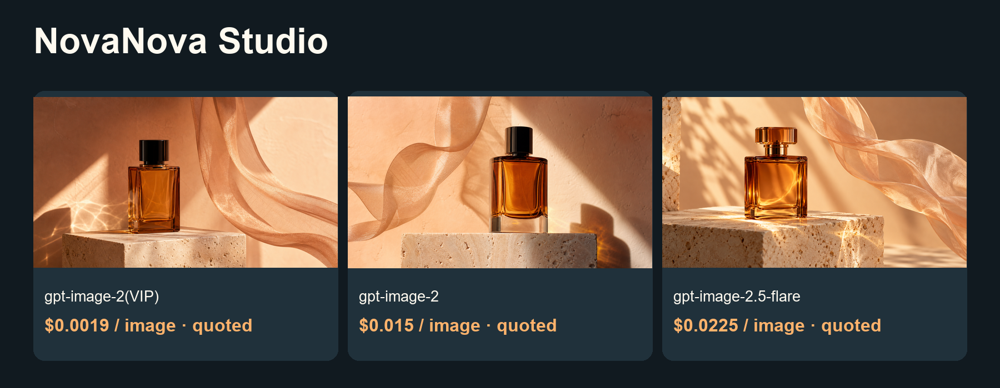

# Lower-cost NovaNova Studio image and video guide


<!-- TOAPIS-MODELS-20261020 -->
## Model support and prices · 2026-10-20

Added standalone API presets: 31 image request templates and 8 video presets. Current-key pricing matches 26 image and 8 video presets; 5 image templates block new paid calls while pricing is unavailable. Native provider/UI/import/render acceptance remains as documented in the original guide below.

| Image model / tested preset | Current preset quote / image | Historical example amount / image | Fee evidence |
|---|---:|---:|---|
| gpt-image-2(VIP)<br><sub>low</sub> | $0.0019/image | **$0.0019/image** | Billing log, phase unknown |
| gpt-image-2.5-flare-vip<br><sub>low</sub> | Current-key quote unavailable | **$0.005272/image**<br><sub>Token-metered; current $/M unavailable. This sample is not a fixed image tariff.</sub> | Task receipt settled |
| nano_banana<br><sub>1K</sub> | $0.012/image | **$0.012/image** | Billing log, phase unknown |
| gemini-nano-banana-2.1<br><sub>1K</sub> | $0.015/image | **$0.015/image** | Billing log, phase unknown |
| gpt-image-2<br><sub>1K</sub> | $0.015/image | **$0.015/image** | Billing log, phase unknown |
| gemini-nano-banana-2.1-vip<br><sub>1K</sub> | $0.02/image | **$0.02/image** | Billing log, phase unknown |
| qwen-image-3.0<br><sub>1K</sub> | Current-key quote unavailable | **$0.021/image** | Billing log, phase unknown |
| gpt-image-2.5-flare<br><sub>high</sub> | $0.0225/image | **$0.0225/image** | Billing log, phase unknown |
| gpt-image-2.5-sunburst<br><sub>high</sub> | $0.0225/image | **$0.0225/image** | Billing log, phase unknown |
| flux-2-pro<br><sub>1K</sub> | $0.025/image | **$0.025/image** | Billing log, phase unknown |
| doubao-seedream-5-0-pro<br><sub>1K</sub> | $0.042857/image | **$0.042856/image** | Billing log, phase unknown |

| Video model | Preset / input | Settled clip charge | File duration | Case USD/s, ascending |
|---|---|---:|---:|---|
| MiniMax-H3-Max-Turbo | 5s / 480P / text-to-video | $0.125/clip | 5.18s | **$0.024131/s**<br><sub>Pricing tariff: $0.025/s</sub> |
| seedance-2-mini | 4s / 480p / first-frame | $0.13338/clip | 4.04s | **$0.033015/s**<br><sub>Pricing tariff: $3.285714/M total tokens</sub> |
| seedance-2-fast | 4s / 480p / text-to-video | $0.214568/clip | 4.04s | **$0.053111/s**<br><sub>Pricing tariff: $5.285714/M total tokens</sub> |
| kling-v3 | 5s / 720p / std / text-to-video | $0.3/clip | 5.04s | **$0.059524/s**<br><sub>Pricing tariff: $0.06/s</sub> |
| MiniMax-H3 | 5s / 768p / text-to-video | $0.32/clip | 5.17s | **$0.061896/s**<br><sub>Pricing tariff: $0.064/s</sub> |
| seedance-2 | 4s / 480p / first-frame | $0.26676/clip | 4.04s | **$0.06603/s**<br><sub>Pricing tariff: $6.571429/M total tokens</sub> |
| kling-3.0-turbo | 4s / 720p / text-to-video | $0.32/clip | 4.04s | **$0.079208/s**<br><sub>Pricing tariff: $0.08/s</sub> |
| seedance-2-5 | 4s / 480p / text-to-video | $0.3883/clip | 4.04s | **$0.096114/s**<br><sub>Pricing tariff: $10/M total tokens</sub> |

Pricing checked 2026-10-20. Image examples are dated 2026-10-17; video examples 2026-10-20. Tables sort by example amount or case USD/s. Presets and input modes differ; this is not a matched-settings quality ranking. Unknown-phase image logs are not confirmed final net settlements. Current quotes and historical amounts are separate. Video charges are billing=settled; case USD/s divides charge by actual file duration, never processing time. Token tariffs appear in small text and do not imply a fixed per-second price.

gpt-image-2(VIP) starts at $0.0019/image; this low/1K preset is $0.0019/image. The standalone sampler has 31 historically successful image request templates and 8 video presets. Current-key pricing matches 26 image and 8 video presets; 5 image templates block new paid submission until an exact price is available.

[Local sampler](toapis-models/README.md) · [Full price table](PRICING.md) · [Original media and fee evidence](https://github.com/ToAPIs-2025/toapis-quickstart/tree/main/tutorials/model-support-2026-10-20)

Original project examples, historical charges and integration instructions follow. Historical amounts are not rewritten as today’s quotes.

<!-- /TOAPIS-MODELS-20261020 -->

Conversations, image/video generation and a reusable creative canvas.

[中文](README_zh-CN.md) · [Model & pricing](https://go2v.toapis.com/1020_nv_g) · [Upstream](https://github.com/Swayingleaves/novanova-studio)

**Independent ToAPIs community guide, not an upstream-endorsed edition.** This validates API cases and configuration/module boundaries; full upstream product acceptance is pending.

## Demo



Video status: the seedance-2-5 submission returned no task ID. Outcome and charge are unconfirmed; no duplicate POST was made and no successful video case is claimed.

## Case amounts and model rates (ascending)

2026-10-20.

| Model / preset | Type | Case amount / quote | Applicable model rate | Fee evidence |
|---|---|---:|---|---|
| gpt-image-2(VIP)<br>low / 1K | image | Quoted $0.0019 | $0.0019/image | Configured rate; task billing unavailable |
| gpt-image-2<br>1K | image | Quoted $0.015 | $0.015/image | Configured rate; task billing unavailable |
| gpt-image-2.5-flare<br>high / 1K | image | Quoted $0.0225 | $0.0225/image | Configured rate; task billing unavailable |

gpt-image-2(VIP) starts at $0.0019/image; this low/1K case is $0.0019/image. Images retain quote labels when task billing is unavailable. Three image models use the same project prompt with different quality presets. Video USD/s is a measured case ratio, not a fixed tariff.

## Project-specific reuse

1. Start the loopback bridge on the same self-hosted server. Configure a custom channel at http://127.0.0.1:8769/v1 with the separate bridge token.
2. For each image model copy the matching text-to-image group fields from integration/novanova-custom-image-groups.json. The wrapper is documentation, not a claimed import endpoint.
3. CustomProviderAdapter only polls VIDEO tasks in the pinned code; the bridge waits for ToAPIs image completion and returns the expected data[0].url synchronously.
4. The native references placeholder is an array, while each ToAPIs image_with_roles item needs a scalar URL. The native poller also needs explicit terminal-status handling. integration/novanova-video-plan.json records both gaps instead of offering a broken paste-ready template.
5. The Spring/Java app, channel persistence, media registration and complete image/video UI workflows remain unverified.

## Run the independent API cases

```powershell
$env:TOAPIS_API_KEY="your_private_key"
python run_case.py --job jobs/gpt-image-2-vip.json
python run_case.py --job jobs/gpt-image-2-vip.json --live
python run_case.py --job jobs/video.json
python run_case.py --job jobs/video.json --live
```

Without --live, only the current key rate is queried. Set a budget locally; the recipe enforces per-request caps, not a hosted-account global spend limit. After errors/timeouts, reconcile the saved task before another submission.

## Optional synchronous compatibility bridge

```powershell
$env:BRIDGE_TOKEN="replace_with_a_separate_random_token_at_least_24_chars"
$env:BRIDGE_PORT="8769"
python bridge.py
```

Binds to 127.0.0.1 only. UI credentials use the separate bridge token. Keep the real generation key in the bridge environment. Preserve upstream outbound/SSRF rules; this is not a public hosted-service endpoint. Image edits are not enabled.

## Original inputs and outputs

```text
An original cinematic product storyboard still: an unbranded amber glass perfume bottle on a pale travertine pedestal, warm peach backdrop, a single translucent fabric ribbon suspended beside it, soft studio sunlight and realistic caustics, refined commercial photography, clear single composition, 16:9 landscape, no lettering, no logos, no watermark.
```

[Jobs](jobs/) · [Original media](examples/) · [Sanitized evidence](evidence/) · [Acceptance](ACCEPTANCE.md) · [Upstream and protocol evidence](UPSTREAM.md)

## License and scope

Original guide/adapter code: MIT. Upstream source and trademarks keep their own license and ownership. The OpenShorts fork retains its upstream MIT license. No existing sponsor/referral links were replaced. No audio integration claim is made.
