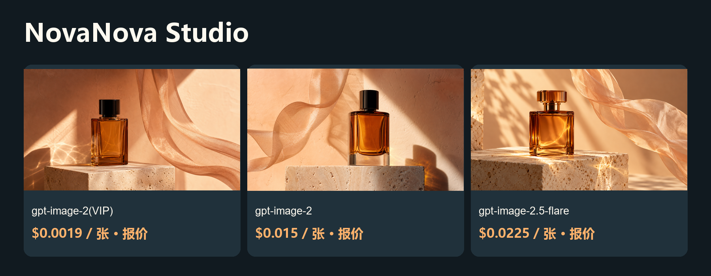

# 更低成本的 NovaNova Studio 图片与视频方案

在对话和画布中生成、比较并复用图片与视频。

[English](README.md) · [Model & pricing](https://go2v.toapis.com/1020_nv_g) · [Upstream](https://github.com/Swayingleaves/novanova-studio)

**ToAPIs独立社区方案，非上游官方版本。** 本轮验证API、配置契约或局部Adapter，完整产品流程尚未验收。

## 演示



视频状态：seedance-2-5提交未返回任务号，结果与费用待核对；没有重复提交，也不计为成功视频案例。

## 本例花费与模型价格（升序）

2026-10-20.

| 模型／档位 | 类型 | 本例金额／报价 | 对应模型价格 | 费用依据 |
|---|---|---:|---|---|
| gpt-image-2(VIP)<br>low / 1K | 图片 | 报价 $0.0019 | $0.0019/image | 档位报价；单任务未返回结算 |
| gpt-image-2<br>1K | 图片 | 报价 $0.015 | $0.015/image | 档位报价；单任务未返回结算 |
| gpt-image-2.5-flare<br>high / 1K | 图片 | 报价 $0.0225 | $0.0225/image | 档位报价；单任务未返回结算 |

gpt-image-2(VIP)通用价格为$0.0019/image起；本例low/1K为$0.0019/image。图片按当期同Key档位报价标识，未把缺失回执写成实扣。三模型使用本项目相同提示词，但质量档位不同，不能视为同等质量比较。视频美元/秒是本例折算，不是固定秒价。

## 对应项目的复用方法

1. 在同一自托管服务端启动回环桥；自定义渠道地址http://127.0.0.1:8769/v1，Key用独立桥接Token。
2. 各图片模型分别复制integration/novanova-custom-image-groups.json中的文生图分组字段；外层包装是说明，不声称存在一键导入接口。
3. 固定版本CustomProviderAdapter只为视频轮询；桥接等待ToAPIs图片完成，再同步返回原生期望的data[0].url。
4. 原生references占位符是数组，ToAPIs image_with_roles每项需要单个URL，原生查询也需明确终态处理。integration/novanova-video-plan.json记录缺口，不提供错误的可粘贴视频模板。
5. Spring/Java应用、渠道保存、媒体入库及完整图片/视频界面流程均未验收。

## 运行独立API案例

```powershell
$env:TOAPIS_API_KEY="your_private_key"
python run_case.py --job jobs/gpt-image-2-vip.json
python run_case.py --job jobs/gpt-image-2-vip.json --live
python run_case.py --job jobs/video.json
python run_case.py --job jobs/video.json --live
```

不加--live仅查当前Key价格。先在本地设置预算；脚本提供单任务限额，不代表托管账户全局消费限制。失败或超时先查保存的原任务，不重复提交。

## 可选同步桥接

```powershell
$env:BRIDGE_TOKEN="replace_with_a_separate_random_token_at_least_24_chars"
$env:BRIDGE_PORT="8769"
python bridge.py
```

只监听127.0.0.1；界面填独立桥接Token，不填写真实ToAPIs Key。不改变上游SSRF/出站策略，不用于公共托管服务。图片仅文生图；视频桥只支持明确的首帧、尺寸与4秒档位。

## 原创输入与输出

```text
An original cinematic product storyboard still: an unbranded amber glass perfume bottle on a pale travertine pedestal, warm peach backdrop, a single translucent fabric ribbon suspended beside it, soft studio sunlight and realistic caustics, refined commercial photography, clear single composition, 16:9 landscape, no lettering, no logos, no watermark.
```

[Jobs](jobs/) · [Original media](examples/) · [Sanitized evidence](evidence/) · [Acceptance](ACCEPTANCE.md) · [Upstream and protocol evidence](UPSTREAM.md)

## 许可与边界

Original guide/adapter code: MIT. Upstream source and trademarks keep their own license and ownership. The OpenShorts fork retains its upstream MIT license. No existing sponsor/referral links were replaced. No audio integration claim is made.
